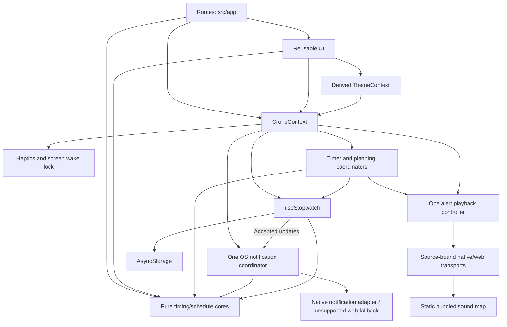

# Architecture: Layered Architecture for CRONO

## Overview

CRONO is a single Expo application organized by technical responsibility. Screens and reusable UI consume shared state through React Context. A persistence hook owns hydration and ordered writes. Pure TypeScript functions define independent stopwatch/countdown/schedule operations, language/sound preferences, semantic notice codes, future notification projection/payload validation, and stored-data validation.

This document adapts Layered Architecture to the existing mobile codebase. The pure core is shared by presentation and state management; accessing that core for calculations or formatting is part of the current design. Persistence remains behind the shared state API.

## Decision Rationale

- **Project type:** A local timekeeping application with stopwatch, timer, planning, and history screens.
- **Stack:** Expo SDK 57, React Native, React, TypeScript, Expo Router, and AsyncStorage.
- **Existing structure:** Technical folders already separate UI, shared state, persistence, and core logic.
- **Key factor:** Keep deterministic timing logic testable while retaining straightforward mobile development.
- **Scope:** Document and extend the current design. Team size and future scaling requirements have not been specified.

## Folder Structure

```text
src/
├── app/
│   ├── _layout.tsx           # Composition root, providers, shell, and tabs
│   ├── index.tsx             # Stopwatch route
│   ├── timer.tsx             # Countdown editor and controls
│   ├── planning.tsx          # Saved schedules, editor, and run replacement
│   └── history.tsx           # History, session details, and sharing
├── components/
│   ├── StopwatchFace.tsx     # Dial and local display refresh
│   ├── TimerFace.tsx         # Local foreground countdown refresh
│   ├── DurationPicker.tsx    # Three localized controlled numeric columns
│   ├── DurationWheel.tsx / .web.tsx # Native adjustable / web spinbutton adapters
│   ├── TimerCompletionNotice.tsx # Persistent completion in shell/sheets
│   ├── PlanningRunCard.tsx   # Schedule controls and local display refresh
│   ├── ScheduleEditorSheet.tsx # Explicit save/discard and virtualized actions
│   ├── ScheduleStepRow.tsx   # Action name, duration summary and reorder controls
│   ├── EditorBody.tsx / .web.tsx # Covered editor keeps its viewport/layout
│   ├── PlanningNotice.tsx    # Current boundary/final event feedback
│   ├── TimingNotices.tsx    # Shared timer/planning notices and playback Stop
│   ├── SystemNotificationNotice.tsx # Independent native failure/retry feedback
│   ├── LapList.tsx           # Lap rows and statistics
│   ├── Sheet.tsx             # Modal and confirmation primitives
│   ├── SettingsSheet.tsx     # User preferences
│   └── Icon.tsx              # Shared SVG icons
├── context/
│   ├── CronoContext.tsx      # Shared state, global runners/audio, mobile feedback
│   └── ThemeContext.tsx      # Saved palette and platform appearance
├── hooks/
│   ├── useStopwatch.ts       # Hydration outcome, accepted updates, ordered storage
│   ├── useI18n.ts            # Saved language projection and shared-state setter
│   ├── durationWheel.ts      # Injected bounded settling/generation controller
│   ├── useDurationWheel.ts   # Committed props, alignment and lifecycle cleanup
│   ├── timerCompletion.ts    # Framework-free injected completion coordinator
│   ├── useTimerCompletion.ts # Global readiness/lifecycle adapter
│   ├── planningRunner.ts     # Injected schedule coordinator and controls
│   ├── usePlanningRunner.ts  # Readiness/lifecycle bridge and boundary feedback
│   ├── alertPlayback.ts      # Injected arbitration, duration, cancellation
│   ├── useAlertPlayback.ts   # One shared playback lifecycle and preview
│   ├── useAlertSound.ts      # Explicit native player creation/release
│   ├── useAlertSound.web.ts  # Source-bound browser media promise/errors
│   ├── notificationCoordinator.ts # Serialized future OS request reconciliation
│   ├── useSystemNotifications.ts # One notification owner and lifecycle bridge
│   ├── notificationTypes.ts # Native-free platform contract and capability policy
│   ├── systemNotifications.ts / .web.ts # Native adapter and unsupported web fallback
│   ├── notificationResponses.ts # Validated/deduplicated/buffered tap handling
│   ├── useNotificationNavigation.ts # Router-ready navigation without run mutations
│   ├── appActivity.ts        # Shared foreground lifecycle adapter
│   └── createTimingId.ts     # Runtime IDs outside pure transitions
├── i18n/
│   ├── types.ts              # Widened catalog contract
│   ├── ro.ts / en.ts / ru.ts  # Stable bundled translated copy/functions
│   ├── index.ts              # Catalog selection with Romanian fallback
│   ├── notificationContent.ts # Localized OS title/body and content fingerprint
│   ├── plurals.ts            # Cached Intl plural phrases
│   └── formatters.ts         # Locale dates/times and session sharing
├── audio/
│   ├── sources.ts            # Static sound asset requires, outside the core
│   └── notificationSounds.ts # Native resource names and stable channel IDs
├── core/
│   ├── stopwatch.ts          # App data, stopwatch, history, validation
│   ├── timer.ts              # Pure countdown model and validation
│   ├── durationPicker.ts     # Numeric parts, bounds, conversion and nearest index
│   ├── planning.ts           # Schedule CRUD, snapshots, cumulative transitions
│   ├── language.ts           # Supported IDs/autonyms/locales and default
│   ├── notifications.ts     # Bounded future events and owned payload validation
│   ├── notices.ts            # Semantic transient toast/completion/audio codes
│   └── sounds.ts             # Pure sound/duration catalog and validation
└── theme.ts                 # Shared visual tokens
tests/
├── language.test.ts          # Defaults and independently restored preference
├── i18n.test.ts              # Catalogs, plural boundaries, dates and sharing
├── stopwatch.test.ts         # Core logic tests
├── timer.test.ts             # Countdown boundaries/transitions
├── durationPicker.test.ts    # Parts, valid bounds and snapping geometry
├── durationWheel.test.ts     # Motion, stale callbacks, disposal and geometry changes
├── timerCompletion.test.ts   # Coordination, cancellation, and audio races
├── theme.test.ts             # Text/surface contrast
├── sounds.test.ts            # Preferences and actual PCM pattern validation
├── planning.test.ts          # Template/run validation and pure transitions
├── alertPlayback.test.ts     # All choices, timing, priority, and cancellation
├── planningRunner.test.ts    # Global execution and lifecycle coordination
├── notifications.test.ts     # Projection, payloads, content, permissions, web policy
├── notificationCoordinator.test.ts # Injected inventory, async races and failures
├── notificationResponses.test.ts # Buffered, validated tap navigation
├── fixtures/                 # Literal pre-planning version-1 saved data
└── e2e/                     # Timing, palettes, languages, notifications, real duration-wheel gestures
assets/audio/                # Original four WAVs and a byte-identical Android-safe Classic copy
```

## Dependency Rules

| Module | Allowed dependencies and responsibilities |
|---|---|
| `src/app/` | Compose UI, use context actions, call pure core helpers, and define Expo Router navigation |
| `src/components/` | Render UI using props, theme, pure core helpers, and shared context when needed |
| `src/context/` | Compose persistence, global timing runners, shared audio, one OS notification owner, notices, mobile feedback, and a derived theme provider |
| `src/hooks/` | Manage state, lifecycle, persistence, timing coordinators, playback arbitration, serialized OS scheduling, and platform audio/notification adapters |
| `src/i18n/` | Framework-free catalogs and Intl presentation helpers; may import pure core types/formatting, never owns state/storage |
| `src/core/` | Use JavaScript/TypeScript primitives and other pure core functions |
| `src/audio/` | Map pure sound IDs to static bundled assets; consumed by platform transports |
| `src/theme.ts` | Export visual constants without depending on application modules |

- Keep platform/storage dependencies outside the pure core.
- Keep reads and writes to local storage in the persistence layer; UI actions use the shared `update` API.
- Keep dependencies directed toward shared lower-level functionality. Core modules do not import translation/presentation, hooks, context, components, or routes.
- Keep reusable modules outside `src/app/`; components and hooks do not import screen implementations.
- Use the existing relative import style. Additional abstraction layers should solve a concrete problem before being introduced.

## Data Flow and Communication



### Startup

`_layout.tsx` composes fonts, safe areas, `CronoProvider`, then `ThemeProvider`. Crono owns one `useStopwatch` instance, timer/planning coordinators, one shared audio controller, and one system notification coordinator. Storage hydration passes JSON through `restoreData`. Interactive tabs wait for both fonts and storage; native splash release also follows those gates. The native launch image precedes saved-data hydration and does not promise the saved theme.

The current error path also becomes ready after a failed read. Its potential to overwrite existing data is an open defect recorded in [DESCRIPTION.md](DESCRIPTION.md), not a guarantee of safe recovery. A separate loading/loaded/failed hydration outcome prevents notification inventory mutation and feature-specific preference writes after a failed read; dismissing the storage banner does not change that outcome.

### User Actions and Persistence

Screens call `update(previous => next)` through `useCrono`. Core functions compute stopwatch transitions; the hook retains the latest state in a ref, updates React state, and queues its serialized snapshot. The write queue preserves action order. Lifecycle events request another snapshot when the app leaves the active state. Stable subscribers run outside updater functions immediately after effective accepted updates, using the current ref; no-op updates and display ticks do not notify them.

Countdown actions use `useCrono().timerControls`; planning execution uses `useCrono().planning.controls`. Both coordinators apply pure transitions through that same `update` API. Its `{ changed, data }` result allows side effects only after an accepted update; `getSnapshot()` supplies fresh state for asynchronous guards. Template CRUD also uses shared functional updates. No additional storage owner is created.

Version 1 and the storage key remain unchanged. Optional independently restored fields include timer, language, theme, sound ID/duration, the default-on `systemNotifications` boolean, and `{ schedules, run }` planning data. The legacy `timerSound` flag controls automatic alerts for both timer and planning. Missing new fields default independently while preserving valid clocks/history and false preferences. Schedule restoration filters invalid templates separately from rejecting an incoherent run snapshot.

A schedule run snapshots its source ID/name/ordered actions. A running or paused source template is protected, while other templates remain editable. Starting another schedule requires confirmed atomic replacement; reset clears only the run. Boundaries use run/index identities and cumulative deadlines. Limits are 20 templates, 50 actions each, 80-character trimmed names, and one second to 23:59:59 per action. These bounds do not resolve the existing oversized-history storage finding.

The current storage unit is the complete `AppData` object at `@crono/app-v1`. Changes to that layout need an explicit compatibility and migration plan; splitting storage is follow-up implementation work.

### Display and Device Behavior

`DurationPicker` composes three numeric columns using pure `durationPicker` helpers. Native columns use finite ScrollViews and adjustable accessibility actions; the web adapter owns CSS snapping, spinbutton semantics, keyboard/row selection and window-level release cleanup. The injected `durationWheel` controller distinguishes user motion from silent alignment, invalidates stale settling callbacks and releases interaction state on cancellation/disable/unmount. `useDurationWheel` binds committed current props and cancels unfinished motion when the app becomes inactive. Font-scale geometry realigns silently; explicit alignment is nonanimated.

The Timer route holds numeric parts and fresh selection/motion refs. Only a settled, effective, valid change configures the existing timer coordinator; Start uses the latest parts and waits until all columns settle. Running/paused wheels are disabled. Zero stays an invalid local selection; focus and same-value alignment do not mutate a completed timer or cancel its audio.

The schedule editor owns one selected action ID and temporary numeric parts inside its existing Sheet. Apply functionally changes that action's draft; Cancel/Back/close abandons temporary parts. Save remains the only template-persistence boundary. `EditorBody` preserves the outer FlatList's layout while the duration/discard panel covers it: native hides interaction/accessibility, while web also uses inertness and hidden visibility to exclude covered controls from tab order. A captured list offset and stable-ID button map restore the action's viewport/focus. Name inputs and shared notices remain separate; no stacked duration Modal, timing runner or storage owner is added.

`StopwatchFace` owns a local timestamp and refreshes the display approximately every 32 ms while running. It derives the elapsed value from the core and listens for app-state changes. Its display refresh does not update the shared persisted object.

`TimerFace` refreshes locally every 200 ms in the foreground. The pure core derives remaining time from the absolute deadline and uses ceiling-based seconds. The provider-level coordinator owns deadline/lifecycle scheduling across route changes. Schedule generations reject obsolete callbacks, including a pause/resume with the same run ID but a new deadline; audio guards recheck run ID, current state, mute, activity, and cancellation after preparation/seek. Accepted foreground completions announce once and may sound. Overdue hydration/background return completes silently; completed hydration does not replay. The bounded in-memory deduplication set is not a second persisted store.

`PlanningRunCard` also refreshes locally every 200 ms in the foreground. The global planning runner advances against each preceding deadline, so callback delays do not extend the sequence. It reconciles multiple crossed actions in one accepted update and publishes only the latest boundary. Hydration and foreground catch-up are silent. The last action emits one final event; paused runs retain exact milliseconds. Generation and fresh-state guards reject stale callbacks without resetting the independent clocks.

`alertPlayback` owns one pending/playing request across timer, planning, and preview. Requests carry owner/event identity, deadline, kind, sound ID/duration, and a current-state guard. Live alerts replace previews; later live deadlines win. Exact ties prefer timer completion, then schedule completion, then action boundary. Sounds are never queued. All four patterns loop; the 5/15/30-second limit starts after playback starts, with a separate four-second startup timeout. Stop and owner cancellation invalidate pending callbacks; settings changes and backgrounding cancel playback. Closing Settings cancels only preview, and explicit preview can work while automatic alerts are muted.

Native audio uses SDK 57 `createAudioPlayer` for each accepted source and explicitly unsubscribes, pauses, and removes it on cancellation/error/unmount. Web uses `expo-asset`, a source-bound `Audio` element, looping, an observed play promise, and error listeners with cleanup. Both transports recheck validity after asynchronous preparation. Playback-only config disables microphone/recording/background behavior and respects native silent mode/mixing. Browser calls/decoding and exports do not prove audible native behavior.

`TimingNotices` composes timer completion, planning boundary/final feedback, and Stop in both shell and active sheets without closing them. Audio failures are scoped to the matching event/run, separate from generic session-save notices. A new event clears obsolete audio feedback. The schedule editor uses controlled drafts, explicit save/discard, and one keyboard-aware FlatList through Sheet's non-scrolling mode.

`ThemeContext` projects saved preferences into stable semantic palettes and cached styles, supplies the navigation theme, and synchronizes native Appearance/SystemUI and status-bar contrast. It has no independent persistence and does not key/remount routes or clock owners.

`useI18n` derives stable module catalogs from the saved `language` preference and applies effective changes through the existing functional update API. Romanian is the manual default; no device locale is detected. The framework-free translation layer owns plural/date/share presentation; `sessionText` lives here rather than in the pure timing core. Catalogs use stable sound IDs and preserve user-entered schedule/action names. Toast, timer-completion and audio-failure values are semantic codes, translated when rendered or announced with a fresh snapshot. Language does not recreate timing/playback controllers, refresh foreground notice lifetimes, or key/remount routes or controlled inputs. It updates future system-notification content through the separate notification owner. Web document language follows selection; native speech voice remains an OS concern.

`CronoContext` owns transient notices and platform-guarded haptics and a single screen wake guard for the OR of running stopwatch, timer, and schedule states. Sharing remains in the history route, with separate mobile and browser paths. Keep mobile-only behavior and browser fallbacks explicit.

### System Notifications

`core/notifications` projects one future timer completion and cumulative remaining schedule boundaries from accepted snapshots, with one final event. It filters elapsed deadlines and has no React, platform, storage or translation dependency. `notificationContent` adds selected-language text and the selected one-shot sound/channel outside the pure core, preserving user names.

`notificationCoordinator` is an injected side-effect owner, not a timing runner or a second store. `useSystemNotifications` subscribes to accepted timer/run and relevant preference updates; successful hydration and foreground return also reconcile. One serialized worker re-reads fresh state, reuses identical requests, and cancels only validated owned requests. Unique physical registration IDs are separate from semantic event/deadline/content identity.

Deferred stale registrations are cancelled by exact ID; cancellation failure blocks that owner's replacement and remains visible until a relevant change or explicit retry. Delivered/elapsed metadata is consumed in a bounded session set to avoid replay, including clock rollback. Failed hydration never enumerates/removes valid native inventory.

The native adapter registers SDK-57 date requests, four versioned sound channels plus silent on Android, and one-shot bundled sound names. A static foreground handler suppresses system banner/list/sound/badge while in-app completion/playback remains unchanged. Future requests stay armed on backgrounding and ordinary cleanup.

Permission is transient, refreshed on foreground, and requested only from accepted user start/resume/restart, enable or explicit permission gestures. Saved opt-in remains independent of denied/limited OS authorization. No push token/server, background JS worker, recording or background audio is used. The web adapter imports no native notification/intent module and reports unsupported; Expo Go/missing native resources report unavailable.

Android exact-alarm special access has a Settings shortcut with app-settings fallback. SDK scheduling can fall back when access is missing; successful registration does not prove access or punctual/audible delivery. Channels and OS settings remain user-controlled. `timerSound` off selects silent visual notifications; 5/15/30-second loops remain in-app only. Failures use a separate retry notice in shell/sheets without replacing timing/audio/session feedback.

Responses are captured before the shell mounts and buffered until successful hydration, fonts and root navigation are ready. Valid owned default-action metadata maps only to `/timer` or `/planning`; arbitrary URLs/actions are ignored. Initial/live responses are deduplicated and handled initial responses consumed. Stale-run taps only navigate, and open drafts/confirmations are retained. Physical delivery, sound, OS policies and cold-launch behavior require a rebuilt native binary/device; browser tests, exports and CNG configuration checks do not prove them.

## Key Principles

1. **Pure calculations:** Keep timing, lap invariants, formatting, and stored-data validation independently testable.
2. **One shared state owner:** Use the existing provider and functional updates for clocks, planning, history, and preference changes.
3. **Local rendering state:** Keep ticking timestamps and modal visibility close to their consumers.
4. **Ordered persistence:** Preserve serialization order and treat storage failures as user-visible state.
5. **Mobile compatibility:** Respect safe areas, accessible controls, lifecycle cleanup, and runtime availability of native modules.
6. **Bounded data:** Respect the session/lap limits and account for serialized size when changing persistence.

## Code Organization Note

Extend the existing folders where practical. Refactor a boundary when the requested behavior needs it; unrelated modules can retain their current organization. Shared pure helpers may be imported directly by screens and components, while side effects remain in hooks, context, or explicit platform handlers.

## Code Examples

### Deterministic Core Behavior

The existing test structure can exercise timing without React or storage:

```ts
// In tests/stopwatch.test.ts
import assert from 'node:assert/strict';
import { elapsed, emptyStopwatch, pause, start } from '../src/core/stopwatch.ts';

const running = start(emptyStopwatch(), 1_000);
const stopped = pause(running, 2_500);

assert.equal(elapsed(stopped, 90_000), 1_500);
```

### UI Delegation Through the Shared State API

The stopwatch screen delegates transitions inside its event handler:

```ts
// In src/app/index.tsx, with update from useCrono and core functions imported
update((previous) => ({
  ...previous,
  stopwatch: previous.stopwatch.startedAt !== null
    ? pause(previous.stopwatch)
    : start(previous.stopwatch),
}));
```

The screen selects the action; core functions calculate the new stopwatch; the hook owns the resulting write.

## Anti-Patterns

- Incrementing accumulated duration on interval callbacks instead of deriving elapsed time from timestamps.
- Writing to AsyncStorage from a screen, row component, or display timer.
- Moving mutable React state or device APIs into `src/core/`.
- Updating shared persisted state on every display refresh.
- Treating a failed initial storage read as evidence that no history exists.
- Assuming a large single JSON entry is safe because the number of sessions is bounded.
- Moving reusable components or utilities into the route directory.
- Treating web tests or bundle exports as physical-device or signed-build validation.

## Related Context

- [DESCRIPTION.md](DESCRIPTION.md): features, stack, storage contract, and known follow-ups.
- [rules/base.md](rules/base.md): project conventions and validation commands.
- [../AGENTS.md](../AGENTS.md): Expo requirements and repository map.
