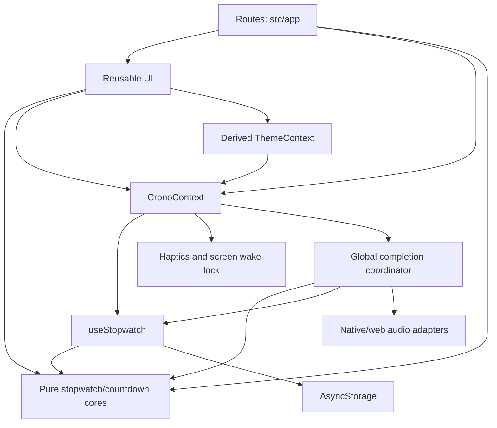

# Architecture: Layered Architecture for CRONO

## Overview

CRONO is a single Expo application organized by technical responsibility. Screens and reusable UI consume shared state through React Context. A persistence hook owns hydration and ordered writes. Pure TypeScript functions define independent stopwatch/countdown operations and stored-data validation.

This document adapts Layered Architecture to the existing mobile codebase. The pure core is shared by presentation and state management; accessing that core for calculations or formatting is part of the current design. Persistence remains behind the shared state API.

## Decision Rationale

- **Project type:** A local timekeeping application with stopwatch, timer, and history screens.
- **Stack:** Expo SDK 57, React Native, React, TypeScript, Expo Router, and AsyncStorage.
- **Existing structure:** Technical folders already separate UI, shared state, persistence, and core logic.
- **Key factor:** Keep deterministic timing logic testable while retaining straightforward mobile development.
- **Scope:** Document and extend the current design. Team size and future scaling requirements have not been specified.

## Folder Structure

```text
src/
├── app/
│   ├── _layout.tsx           # Composition root, providers, shell, and tabs
│   ├── index.tsx             # Stopwatch route
│   ├── timer.tsx             # Countdown editor and controls
│   └── history.tsx           # History, session details, and sharing
├── components/
│   ├── StopwatchFace.tsx     # Dial and local display refresh
│   ├── TimerFace.tsx         # Local foreground countdown refresh
│   ├── TimerCompletionNotice.tsx # Persistent completion in shell/sheets
│   ├── LapList.tsx           # Lap rows and statistics
│   ├── Sheet.tsx             # Modal and confirmation primitives
│   ├── SettingsSheet.tsx     # User preferences
│   └── Icon.tsx              # Shared SVG icons
├── context/
│   ├── CronoContext.tsx      # Shared state, completion/audio, mobile feedback
│   └── ThemeContext.tsx      # Saved palette and platform appearance
├── hooks/
│   ├── useStopwatch.ts       # Local storage and state updates
│   ├── timerCompletion.ts    # Framework-free injected completion coordinator
│   ├── useTimerCompletion.ts # Global readiness/lifecycle adapter
│   ├── useTimerSound.ts      # Managed native audio
│   └── useTimerSound.web.ts  # Browser media promise/error handling
├── core/
│   ├── stopwatch.ts          # App data, stopwatch, history, validation
│   └── timer.ts              # Pure countdown model and validation
└── theme.ts                 # Shared visual tokens
tests/
├── stopwatch.test.ts         # Core logic tests
├── timer.test.ts             # Countdown boundaries/transitions
├── timerCompletion.test.ts   # Coordination, cancellation, and audio races
├── theme.test.ts             # Text/surface contrast
└── e2e/                     # Stopwatch, theme, and timer scenarios
assets/audio/timer-complete.wav # Original bundled completion effect
```

## Dependency Rules

| Module | Allowed dependencies and responsibilities |
|---|---|
| `src/app/` | Compose UI, use context actions, call pure core helpers, and define Expo Router navigation |
| `src/components/` | Render UI using props, theme, pure core helpers, and shared context when needed |
| `src/context/` | Compose persistence, global completion/audio, notices, mobile feedback, and a derived theme provider |
| `src/hooks/` | Manage state, lifecycle, persistence, completion scheduling, and platform audio adapters |
| `src/core/` | Use JavaScript/TypeScript primitives and other pure core functions |
| `src/theme.ts` | Export visual constants without depending on application modules |

- Keep platform/storage dependencies outside the pure core.
- Keep reads and writes to local storage in the persistence layer; UI actions use the shared `update` API.
- Keep dependencies directed toward shared lower-level functionality. Core modules do not import hooks, context, components, or routes.
- Keep reusable modules outside `src/app/`; components and hooks do not import screen implementations.
- Use the existing relative import style. Additional abstraction layers should solve a concrete problem before being introduced.

## Data Flow and Communication



### Startup

`_layout.tsx` composes fonts, safe areas, `CronoProvider`, then `ThemeProvider`. Crono owns one `useStopwatch` instance and the global completion/audio hooks. Storage hydration passes JSON through `restoreData`. Interactive tabs wait for both fonts and storage; native splash release also follows those gates. The native launch image precedes saved-data hydration and does not promise the saved theme.

The current error path also becomes ready after a failed read. Its potential to overwrite existing data is an open defect recorded in [DESCRIPTION.md](DESCRIPTION.md), not a guarantee of safe recovery.

### User Actions and Persistence

Screens call `update(previous => next)` through `useCrono`. Core functions compute stopwatch transitions; the hook retains the latest state in a ref, updates React state, and queues its serialized snapshot. The write queue preserves action order. Lifecycle events request another snapshot when the app leaves the active state.

Countdown actions use `useCrono().timerControls`, whose coordinator applies pure transitions through that same `update` API. Its `{ changed, data }` result allows side effects only after an accepted update; `getSnapshot()` supplies fresh state after asynchronous audio setup. Neither API creates another storage owner. Version 1 adds optional independently restored timer/theme/sound fields while keeping the existing key and legacy stopwatch/history.

The current storage unit is the complete `AppData` object at `@crono/app-v1`. Changes to that layout need an explicit compatibility and migration plan; splitting storage is follow-up implementation work.

### Display and Device Behavior

`StopwatchFace` owns a local timestamp and refreshes the display approximately every 32 ms while running. It derives the elapsed value from the core and listens for app-state changes. Its display refresh does not update the shared persisted object.

`TimerFace` refreshes locally every 200 ms in the foreground. The pure core derives remaining time from the absolute deadline and uses ceiling-based seconds. The provider-level coordinator owns deadline/lifecycle scheduling across route changes. Schedule generations reject obsolete callbacks, including a pause/resume with the same run ID but a new deadline; audio guards recheck run ID, current state, mute, activity, and cancellation after preparation/seek. Accepted foreground completions announce once and may sound. Overdue hydration/background return completes silently; completed hydration does not replay. The bounded in-memory deduplication set is not a second persisted store.

Native audio uses managed `expo-audio` resources; web uses `expo-asset` plus an observed media play promise for recoverable autoplay rejection. Both adapters accept the coordinator's final-play guard. Playback-only config disables microphone/recording/background behavior. `TimerCompletionNotice` projects completed state into both shell and active modal sheets without closing them.

`ThemeContext` projects saved preferences into stable semantic palettes and cached styles, supplies the navigation theme, and synchronizes native Appearance/SystemUI and status-bar contrast. It has no independent persistence and does not key/remount routes or clock owners.

`CronoContext` owns transient notices and platform-guarded haptics and a single screen wake guard for either running clock. Sharing remains in the history route, with separate mobile and browser paths. Keep mobile-only behavior and browser fallbacks explicit.

## Key Principles

1. **Pure calculations:** Keep timing, lap invariants, formatting, and stored-data validation independently testable.
2. **One shared state owner:** Use the existing provider and functional updates for stopwatch, history, and preference changes.
3. **Local rendering state:** Keep ticking timestamps and modal visibility close to their consumers.
4. **Ordered persistence:** Preserve serialization order and treat storage failures as user-visible state.
5. **Mobile compatibility:** Respect safe areas, accessible controls, lifecycle cleanup, and runtime availability of native modules.
6. **Bounded data:** Respect the session/lap limits and account for serialized size when changing persistence.

## Code Organization Note

Extend the existing folders where practical. Refactor a boundary when the requested behavior needs it; unrelated modules can retain their current organization. Shared pure helpers may be imported directly by screens and components, while side effects remain in hooks, context, or explicit platform handlers.

## Code Examples

### Deterministic Core Behavior

The existing test structure can exercise timing without React or storage:

```ts
// In tests/stopwatch.test.ts
import assert from 'node:assert/strict';
import { elapsed, emptyStopwatch, pause, start } from '../src/core/stopwatch.ts';

const running = start(emptyStopwatch(), 1_000);
const stopped = pause(running, 2_500);

assert.equal(elapsed(stopped, 90_000), 1_500);
```

### UI Delegation Through the Shared State API

The stopwatch screen delegates transitions inside its event handler:

```ts
// In src/app/index.tsx, with update from useCrono and core functions imported
update((previous) => ({
  ...previous,
  stopwatch: previous.stopwatch.startedAt !== null
    ? pause(previous.stopwatch)
    : start(previous.stopwatch),
}));
```

The screen selects the action; core functions calculate the new stopwatch; the hook owns the resulting write.

## Anti-Patterns

- Incrementing accumulated duration on interval callbacks instead of deriving elapsed time from timestamps.
- Writing to AsyncStorage from a screen, row component, or display timer.
- Moving mutable React state or device APIs into `src/core/`.
- Updating shared persisted state on every display refresh.
- Treating a failed initial storage read as evidence that no history exists.
- Assuming a large single JSON entry is safe because the number of sessions is bounded.
- Moving reusable components or utilities into the route directory.
- Treating web tests or bundle exports as physical-device or signed-build validation.

## Related Context

- [DESCRIPTION.md](DESCRIPTION.md): features, stack, storage contract, and known follow-ups.
- [rules/base.md](rules/base.md): project conventions and validation commands.
- [../AGENTS.md](../AGENTS.md): Expo requirements and repository map.
