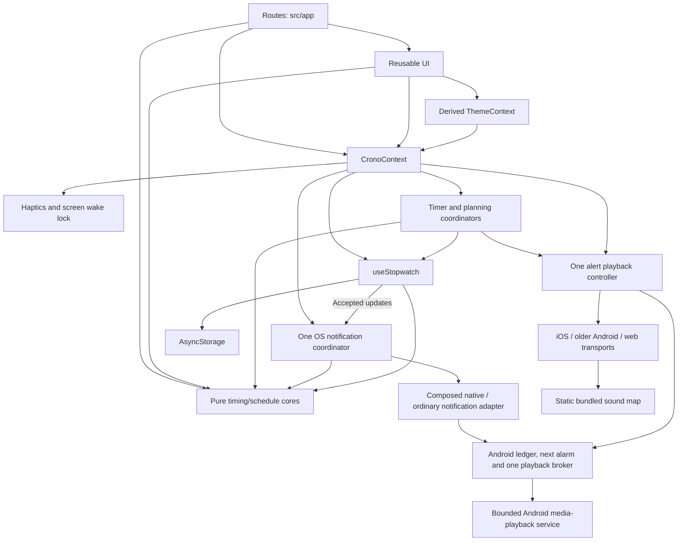

# Architecture: Layered Architecture for CRONO

## Overview

CRONO is a single Expo application organized by technical responsibility. Screens and reusable UI consume shared state through React Context. A persistence hook owns hydration and ordered writes. Pure TypeScript functions define independent stopwatch/countdown/schedule operations, language/sound preferences, semantic notice codes, future notification projection/payload validation, and stored-data validation.

This document adapts Layered Architecture to the existing mobile codebase. The pure core is shared by presentation and state management; accessing that core for calculations or formatting is part of the current design. Persistence remains behind the shared state API.

## Decision Rationale

- **Project type:** A local timekeeping application with stopwatch, timer, planning, and history screens.
- **Stack:** Expo SDK 57, React Native, React, TypeScript, Expo Router, and AsyncStorage.
- **Existing structure:** Technical folders already separate UI, shared state, persistence, and core logic.
- **Key factor:** Keep deterministic timing logic testable while retaining straightforward mobile development.
- **Scope:** Document and extend the current design. Team size and future scaling requirements have not been specified.

## Folder Structure

```text
src/
├── app/
│   ├── _layout.tsx           # Composition root, providers, shell, and tabs
│   ├── index.tsx             # Stopwatch route
│   ├── timer.tsx             # Countdown editor and controls
│   ├── planning.tsx          # Saved schedules, editor, and run replacement
│   └── history.tsx           # History, session details, and sharing
├── components/
│   ├── StopwatchFace.tsx     # Dial and local display refresh
│   ├── TimerFace.tsx         # Local foreground countdown refresh
│   ├── DurationPicker.tsx    # Three localized controlled numeric columns
│   ├── DurationWheel.tsx / .web.tsx # Native adjustable / web spinbutton adapters
│   ├── TimerCompletionNotice.tsx # Persistent completion in shell/sheets
│   ├── PlanningRunCard.tsx   # Schedule controls and local display refresh
│   ├── ScheduleEditorSheet.tsx # Explicit save/discard and virtualized actions
│   ├── ScheduleStepRow.tsx   # Action name, duration summary and reorder controls
│   ├── ScheduleCalendarPanel.tsx # Calendar rule draft in the existing editor sheet
│   ├── CalendarDateFields.tsx # Shared day, month and year entry
│   ├── EditorBody.tsx / .web.tsx # Covered editor keeps its viewport/layout
│   ├── PlanningNotice.tsx    # Current boundary/final event feedback
│   ├── TimingNotices.tsx    # Shared timer/planning notices and playback Stop
│   ├── SystemNotificationNotice.tsx # Independent native failure/retry feedback
│   ├── LapList.tsx           # Lap rows and statistics
│   ├── Sheet.tsx             # Modal and confirmation primitives
│   ├── ActiveActivities.tsx  # Other-tab Timer/Planning controls and local display
│   ├── ScheduleCard.tsx      # Primary Start and secondary action disclosure
│   ├── ScheduleRepeatPanel.tsx # Explicit flat repeated-sequence draft preview
│   ├── BackupSettings.tsx    # File transfer review and optional preferences
│   ├── SettingsSheet.tsx     # Grouped user preferences
│   ├── NavigationScene.tsx / .web.tsx # Focus gates around navigator-owned slides
│   ├── PanelTransition.tsx   # Stable incoming-only presentation frame
│   ├── MotionPressable.tsx   # One ref-safe Pressable host with finite visual feedback
│   └── Icon.tsx              # Shared SVG icons
├── context/
│   ├── CronoContext.tsx      # Shared state, global runners/audio, mobile feedback
│   ├── ThemeContext.tsx      # Saved palette and platform appearance
│   └── MotionContext.tsx     # One reduced-motion/activity owner and covered scopes
├── hooks/
│   ├── useStopwatch.ts       # Hydration outcome, accepted updates, ordered storage
│   ├── useI18n.ts            # Saved language projection and shared-state setter
│   ├── themeAppearance.ts / useSystemTheme.ts # Appearance lifecycle and native background ordering
│   ├── motionPreference.ts  # Injected live OS-query/event ordering and foreground refresh
│   ├── transitionMotion.ts / useSheetMotion.ts # Finite presence and Animated lifecycle bridge
│   ├── useSheetPresentation.ts # Token-guarded exit payload, separate from logical visibility
│   ├── pressMotion.ts / usePressMotion.ts # Cancellable visual controller and Animated binding
│   ├── backupTransfer.ts / useBackupTransfer.ts # Fenced file operations and accepted imports
│   ├── backupFiles.ts / .web.ts # Native system picker/share and browser upload/download
│   ├── useForegroundNow.ts   # Presentation ticks only while active
│   ├── sheetIsolation.ts / .web.ts # Native Modal / reference-counted web isolation
│   ├── durationWheel.ts      # Injected bounded manual settling/generation controller
│   ├── wheelPresentation.ts  # Finite preset scrolling; no selection or busy ownership
│   ├── useDurationWheel.ts   # Committed props, alignment and lifecycle cleanup
│   ├── timerCompletion.ts    # Framework-free injected completion coordinator
│   ├── useTimerCompletion.ts # Global readiness/lifecycle adapter
│   ├── planningRunner.ts     # Injected schedule coordinator and controls
│   ├── usePlanningRunner.ts  # Readiness/lifecycle bridge and boundary feedback
│   ├── alertPlayback.ts      # Injected arbitration, duration, cancellation
│   ├── useAlertPlayback.ts   # One shared playback lifecycle and preview
│   ├── nativeAlertPlayback.ts # Android broker facade, snapshots and scoped Stop
│   ├── completionAlerts.ts / .web.ts # Optional protocol bridge / native-free fallback
│   ├── completionNotificationAdapter.ts # Native/ordinary delivery under one owner
│   ├── useAlertSound.ts      # Explicit native player creation/release
│   ├── useAlertSound.web.ts  # Source-bound browser media promise/errors
│   ├── notificationCoordinator.ts # Serialized future OS request reconciliation
│   ├── useSystemNotifications.ts # One notification owner and lifecycle bridge
│   ├── notificationTypes.ts # Native-free platform contract and capability policy
│   ├── notificationReadiness.ts # Permission, channel, access and registration policy
│   ├── notificationTrigger.ts # Native-only date quantization; exact semantic deadlines
│   ├── notificationPresentation.ts # Current-activity system presentation policy
│   ├── backgroundAccess.ts / .web.ts # Optional read-only capability bridge
│   ├── systemNotifications.ts / .web.ts # Native adapter and unsupported web fallback
│   ├── notificationResponses.ts # Validated/deduplicated/buffered tap handling
│   ├── useNotificationNavigation.ts # Router-ready navigation without run mutations
│   ├── appActivity.ts        # Shared foreground lifecycle adapter
│   └── createTimingId.ts     # Runtime IDs outside pure transitions
├── i18n/
│   ├── types.ts              # Widened catalog contract
│   ├── ro.ts / en.ts / ru.ts  # Stable bundled translated copy/functions
│   ├── es.ts / fr.ts / de.ts  # Spanish, French and German copy/functions
│   ├── index.ts              # Catalog selection with Romanian fallback
│   ├── notificationContent.ts # Localized OS title/body and content fingerprint
│   ├── plurals.ts            # Cached Intl plural phrases
│   └── formatters.ts         # Locale dates/times and session sharing
├── audio/
│   ├── sources.ts            # Static sound asset requires, outside the core
│   └── notificationSounds.ts # Native resource names and stable channel IDs
├── core/
│   ├── stopwatch.ts          # App data, stopwatch, history, validation
│   ├── timer.ts              # Pure countdown model and validation
│   ├── durationPicker.ts     # Numeric parts, bounds, conversion and nearest index
│   ├── planning.ts           # Schedule CRUD, snapshots, cumulative transitions
│   ├── planningTools.ts      # Templates, duplicate IDs and flat bounded repetitions
│   ├── backup.ts             # Strict portable records and atomic additive merge
│   ├── planningCalendar.ts   # Civil dates and recurring or one-time rules
│   ├── language.ts           # Supported IDs/autonyms/locales and default
│   ├── themePreference.ts    # Saved System/Light/Dark and resolved palette mode
│   ├── notifications.ts     # Bounded future events and owned payload validation
│   ├── completionAlerts.ts   # Validated completion policy, identity and priority
│   ├── notices.ts            # Semantic transient toast/completion/audio codes
│   └── sounds.ts             # Pure sound/duration catalog and validation
└── theme.ts                 # Shared visual tokens
tests/
├── language.test.ts          # Defaults and independently restored preference
├── i18n.test.ts              # Catalogs, plural boundaries, dates and sharing
├── stopwatch.test.ts         # Core logic tests
├── timer.test.ts             # Countdown boundaries/transitions
├── durationPicker.test.ts    # Parts, valid bounds and snapping geometry
├── durationWheel.test.ts     # Motion, stale callbacks, disposal and geometry changes
├── wheelPresentation.test.ts # Visual target replacement, takeover, lifecycle and failures
├── transitionMotion.test.ts  # Readiness, cancellation, reopening, policy and failure fallback
├── timerCompletion.test.ts   # Coordination, cancellation, and audio races
├── theme.test.ts             # Text/surface contrast
├── themeAppearance.test.ts   # Appearance cache/lifecycle and native background races
├── sounds.test.ts            # Preferences and actual PCM pattern validation
├── planning.test.ts          # Template/run validation and pure transitions
├── alertPlayback.test.ts     # All choices, timing, priority, and cancellation
├── completionAlerts.test.ts  # Shared protocol, fixture priority and minute boundary
├── nativeAlertPlayback.test.ts # Android facade, detached lifecycle and bridge races
├── completionNotificationAdapter.test.ts # Real composed-adapter reconciliation
├── planningRunner.test.ts    # Global execution and lifecycle coordination
├── notifications.test.ts     # Projection, payloads, content, permissions, web policy
├── notificationCoordinator.test.ts # Injected inventory, async races and failures
├── notificationResponses.test.ts # Buffered, validated tap navigation
├── fixtures/                 # Literal pre-planning version-1 saved data
└── e2e/                     # Timing, palettes, languages, notifications, real duration-wheel gestures
assets/audio/                # Original four WAVs and a byte-identical Android-safe Classic copy
assets/audio/notifications/  # Four generated 15-second native notification clips
scripts/generate-notification-sounds.mjs # Deterministic PCM asset generation, separate from runtime
modules/crono-background-access/ # Read-only Android capability probe
modules/crono-completion-alerts/ # Atomic delivery ledger, alarm, bounded player/service
```

## Dependency Rules

| Module | Allowed dependencies and responsibilities |
|---|---|
| `src/app/` | Compose UI, use context actions, call pure core helpers, and define Expo Router navigation |
| `src/components/` | Render UI using props, theme, pure core helpers, and shared context when needed |
| `src/context/` | Compose persistence, global timing runners, shared audio, one OS notification owner, notices, mobile feedback, derived theme and transient motion providers |
| `src/hooks/` | Manage state, lifecycle, persistence, timing coordinators, playback arbitration, serialized OS scheduling, file transfer lifecycle, and platform file/audio/notification adapters |
| `src/i18n/` | Framework-free catalogs and Intl presentation helpers; may import pure core types/formatting, never owns state/storage |
| `src/core/` | Use JavaScript/TypeScript primitives and other pure core functions |
| `src/audio/` | Map pure sound IDs to static bundled assets; consumed by platform transports |
| `src/theme.ts` | Export visual constants without depending on application modules |
| `modules/crono-completion-alerts/` | Android delivery projections/receipts and one native audio owner; never edit app clocks/history |

- Keep platform/storage dependencies outside the pure core.
- Keep reads and writes to local storage in the persistence layer; UI actions use the shared `update` API.
- Keep dependencies directed toward shared lower-level functionality. Core modules do not import translation/presentation, hooks, context, components, or routes.
- Keep reusable modules outside `src/app/`; components and hooks do not import screen implementations.
- Use the existing relative import style. Additional abstraction layers should solve a concrete problem before being introduced.

## Portable Data Transfers

`BackupSettings` uses `useBackupTransfer` / the injected `backupTransfer` owner for one file operation at a time. Platform adapters own picker/share/download resources. Native file modules load on demand, so a missing module in an older binary reports an unavailable operation without being required during startup.

`core/backup.ts` projects saved records and preferences only, validates its independent portable envelope strictly, and merges fresh-ID copies additively. The transfer owner generates IDs outside the pure core and confirms through the existing functional `update` against the latest loaded state. Current stopwatch/timer/run references stay owned by the existing store and coordinators. File selection, preview, cancellation and display ticks do not write data. Accepted updates and durable storage writes remain distinct; existing storage failure feedback is retained.

## Data Flow and Communication



### Startup

`_layout.tsx` composes fonts, safe areas, `CronoProvider`, then `ThemeProvider`. Crono owns one `useStopwatch` instance, timer/planning coordinators, one shared audio controller, and one system notification coordinator. Storage hydration passes JSON through `restoreData`. Interactive tabs wait for both fonts and storage; native splash release also follows those gates. The native launch image precedes saved-data hydration and does not promise the saved theme.

The current error path also becomes ready after a failed read. Its potential to overwrite existing data is an open defect recorded in [DESCRIPTION.md](DESCRIPTION.md), not a guarantee of safe recovery. A separate loading/loaded/failed hydration outcome prevents notification inventory mutation and feature-specific preference writes after a failed read; dismissing the storage banner does not change that outcome.

### User Actions and Persistence

Screens call `update(previous => next)` through `useCrono`. Core functions compute stopwatch transitions; the hook retains the latest state in a ref, updates React state, and queues its serialized snapshot. The write queue preserves action order. Lifecycle events request another snapshot when the app leaves the active state. Stable subscribers run outside updater functions immediately after effective accepted updates, using the current ref; no-op updates and display ticks do not notify them.

Countdown actions use `useCrono().timerControls`; planning execution uses `useCrono().planning.controls`. Both coordinators apply pure transitions through that same `update` API. Its `{ changed, data }` result allows side effects only after an accepted update; `getSnapshot()` supplies fresh state for asynchronous guards. Template CRUD also uses shared functional updates. No additional storage owner is created.

Version 1 and the storage key remain unchanged. Optional independently restored fields include timer, language, theme, sound ID/duration, the default-on `systemNotifications` boolean, and `{ schedules, run }` planning data. The legacy `timerSound` flag controls automatic alerts for both timer and planning. Missing new fields default independently while preserving valid clocks/history and false preferences. Schedule restoration filters invalid templates separately from rejecting an incoherent run snapshot.

A schedule run snapshots its source ID/name/ordered actions. A running or paused source template is protected, while other templates remain editable. Starting another schedule requires confirmed atomic replacement; reset clears only the run. Boundaries use run/index identities and cumulative deadlines. Limits are 20 templates, 50 actions each, 80-character trimmed names, and one second to 23:59:59 per action. These bounds do not resolve the existing oversized-history storage finding.

The eight bundled Planning presets are separate from the saved-schedule limit. `planningTools` owns their ordered duration tuples; the i18n catalog type derives each template ID and action-label count through type-only imports. The route combines those values with fresh IDs into an ordinary detached schedule, adding the selected one-time date when applicable. The chooser stays in the main list header and never persists or starts a run. Save stores full text/actions rather than a preset reference, so restoration, language selection and portable imports keep existing schedules independent of the built-in catalog.

The current storage unit is the complete `AppData` object at `@crono/app-v1`. Changes to that layout need an explicit compatibility and migration plan; splitting storage is follow-up implementation work.

### Display and Device Behavior

`DurationPicker` composes three numeric columns using pure `durationPicker` helpers. Native columns use finite ScrollViews and adjustable accessibility actions, using numeric deceleration candidates Android 0.995 / iOS 0.999 for gentler coasting, pending physical acceptance; the web adapter owns CSS snapping, spinbutton semantics, keyboard/row selection and window-level release cleanup. The injected `durationWheel` controller distinguishes user motion from silent alignment, invalidates stale settling callbacks and releases interaction state on cancellation/disable/unmount. `useDurationWheel` binds committed current props and cancels unfinished motion when the app becomes inactive. Font-scale geometry realigns silently; ordinary controlled-value alignment is nonanimated.

Timer alone publishes an explicit local preset revision and route eligibility. The separate injected `wheelPresentation` owner scrolls native/web adapters toward the already accepted value, with one finite fallback and generation-fenced cleanup. It cannot select data or report manual busy state. Lifecycle settlement uses compositor cancellation on web; manual takeover retains the displayed offset, ignoring a cancelled nearest-snap end until displacement or manual fallback. Temporary cancellation offsets remain presentation only.

For cancelable browser wheel/trackpad events, the adapter suppresses default scrolling and injects the finite cubic-ease-out `wheelDeceleration` driver, normalized by pixel/line/page units. Each glide lasts 270–720 ms according to its row distance, with the existing independent deadline 40 ms later. It owns visual offsets only; `durationWheel` still owns busy and accepted selection. Each request has one frame writer and an independent terminal deadline, with generation-fenced cancellation and exact row alignment. Fractional streams accumulate and reversal rebases on the visible position. Browser touch and noncancelable/modifier events retain platform behavior; reduced motion bypasses added interpolation. Explicit choices and presets replace unfinished manual motion; lifecycle/configuration changes invalidate obsolete writes. No wheel physics or presentation state is persisted.

The Timer route holds numeric parts and fresh selection/motion refs. Settled manual choices and accepted quick presets configure the existing timer coordinator only for effective, valid changes; Start uses the latest parts and waits for genuine manual motion. Preset selection updates all parts immediately while changed columns glide, so Start and later presets remain available. Reduced motion, backgrounding, blur, disablement and geometry changes settle obsolete presentation without replay; Starting unmounts its wheels. No revision or motion state is persisted. Running/paused views hide the wheels. Zero stays an invalid local selection; focus and same-value alignment do not mutate a completed timer or cancel its audio.

The schedule editor owns one selected action ID and temporary numeric parts inside its existing Sheet. Apply functionally changes that action's draft; Cancel/Back/close abandons temporary parts. Save remains the only template-persistence boundary. One FlatList owns the whole draft: its stable header element contains the name, Scheduling, Repeat and count/total; its footer contains Add, errors and Save. Actions remain virtualized with stable IDs, without a surrounding vertical ScrollView. `EditorBody` preserves that list's layout while duration/calendar/repeat/discard content covers it: native hides interaction/accessibility, while web also uses inertness and hidden visibility to exclude covered controls from tab order. Each active panel has one bounded body ScrollView, with numeric duration columns as independent input scrollers. A captured whole-list offset and pending source target restore the opening position/focus; a virtualized action target remains pending until its button registers. Shared timing notices remain accessible through Sheet. No stacked duration Modal, timing runner or storage owner is added. The title/Close placement remains unchanged pending the explicit choice in the active scrolling plan.

Each saved schedule can store an optional calendar rule with ISO weekdays or one civil date. The schedule parser validates new rules and the restoration path recovers a valid template as Manual when its stored rule is invalid. The calendar panel updates the editor draft on Apply and Save persists the template. The Planning date filter uses the same date fields and pure matching, with the active run in the list header. Explicit Start and the replacement confirmation own execution.

`StopwatchFace` owns a local timestamp and refreshes the display approximately every 32 ms while running. It derives the elapsed value from the core and listens for app-state changes. Its display refresh does not update the shared persisted object.

`TimerFace` refreshes locally every 200 ms in the foreground. The pure core derives remaining time from the absolute deadline and uses ceiling-based seconds. The provider-level coordinator owns deadline/lifecycle scheduling across route changes. Schedule generations reject obsolete callbacks, including a pause/resume with the same run ID but a new deadline; audio guards recheck run ID, current state, mute, activity, and cancellation after preparation/seek. Accepted foreground completions announce once and may sound. Overdue hydration/background return completes silently; completed hydration does not replay. The bounded in-memory deduplication set is not a second persisted store.

`PlanningRunCard` also refreshes locally every 200 ms in the foreground. The global planning runner advances against each preceding deadline, so callback delays do not extend the sequence. It reconciles multiple crossed actions in one accepted update and publishes only the latest boundary. Hydration and foreground catch-up are silent. The last action emits one final event; paused runs retain exact milliseconds. Generation and fresh-state guards reject stale callbacks without resetting the independent clocks.

One effective playback owner handles timer, planning and preview. Requests carry owner/run/event identity, deadline, kind, sound ID/duration and a current-state guard. Live alerts replace previews; later live deadlines win. Exact ties prefer timer completion, then final schedule, then action boundary; sounds are never queued. Four patterns loop for 5/15/30/60 seconds from actual audio start, with a separate four-second startup timeout. Missing/invalid duration defaults to 60; every valid saved choice is retained. Explicit Stop, pause/reset/replacement and sound/duration/mute changes invalidate obsolete playback. Closing Settings cancels only preview, which remains available while automatic alerts are muted.

`useAlertPlayback` selects the optional Android protocol-v1 broker facade when present and disables Expo audio initialization there. `nativeAlertPlayback` mirrors versioned generation/revision snapshots, serializes accepted policy after successful hydration, rejects stale bridge results and never retries potentially accepted audio through Expo. Native timer/planning playback survives lifecycle suspension and provider detach when background delivery is allowed; explicit cancellation remains separate. Preview stops on background. iOS/web and older binaries retain `alertPlayback` with foreground-only lifecycle cancellation.

iOS/older Android audio uses SDK 57 `createAudioPlayer` with explicit source cleanup. Web uses `expo-asset`, a source-bound `Audio` element, an observed play promise and error listeners. Android's broker uses one MediaPlayer, a monotonic duration deadline, audio focus and a bounded partial wake lock. Background delivery promotes a `mediaPlayback` foreground service before requesting focus; a foreground-to-background handoff preserves the same player/start budget. Stop/error/expiry release resources. Silent/DND/channel settings remain authoritative. Expo recording and iOS background modes remain disabled; browser calls, exports and native unit tests do not prove physical audibility.

`TimingNotices` composes timer completion, planning boundary/final feedback, and Stop in both shell and active sheets without closing them. Audio failures are scoped to the matching event/run, separate from generic session-save notices. A new event clears obsolete audio feedback. The schedule editor uses controlled drafts, explicit save/discard, and one keyboard-aware FlatList through Sheet's non-scrolling mode.

`core/themePreference` separates the saved System/Light/Dark preference from a resolved Light/Dark mode. Fresh/missing/invalid values default to System; valid manual saves remain authoritative. Unavailable system appearance resolves to Light. Portable files store the selected preference and accept all three values without changing either version-1 envelope.

`useSystemTheme` binds an injected `themeAppearance` observer to native/web Appearance and foreground events. Native manual selection applies an app override; System clears it with the installed React Native 0.86 `unspecified` value and explicitly rereads the snapshot. Foreground System refresh also clears/rereads the native cache to recover a missed background change. Web observes its existing media-query adapter without calling a native override API. Subscriptions clean up and stale callbacks cannot publish. Theme selection requires loaded hydration and uses the shared functional update API; device-only changes never update AppData.

`ThemeContext` projects the resolved mode into stable semantic palettes/cached styles and navigation/status contrast. A serialized latest-value native background writer prevents older asynchronous updates from winning; web sets document color scheme and body background directly. It has no independent persistence and does not key/remount routes, clock/audio owners or editor drafts. The pre-hydration native launch image and branding remain separate.

`MotionProvider` owns one AccessibilityInfo reduced-motion subscription and one shared app-activity subscription through `motionPreference`. It subscribes before querying, fences stale reads/events, refreshes on foreground return and starts conservatively with reduced motion. `MotionScope` suspends hidden Sheet/covered EditorBody controls without a layout wrapper or remounting drafts. Motion state never enters AppData.

`MotionPressable` forwards the actual View ref and stock Pressable props, including Router-injected link/click behavior. Its adapter resolves callback styles inside Pressable, outside Animated's style flattening. `usePressMotion` binds one stable value to the injected `pressMotion` visual controller; normal presses use finite 90 ms down / 140 ms return opacity/scale transitions, with the native driver on mobile and non-interaction animations. Reduced motion uses immediate opacity without scaling. Cancellation, disablement, inactivity, covered surfaces and disposal stop obsolete transitions; animation callbacks never execute domain actions. Web switches animate only thumb transform/track color; native Switch, wheel gestures and passive clock/notice rendering keep their existing owners. Haptics and audio stay in CronoContext.

The public SDK-57 `expo-router/js-tabs` navigator owns the four routes' 180 ms horizontal slide. A stable `sceneStyleInterpolator`, typed through public `BottomTabNavigationOptions`, maps its signed route progress to the measured application's width. Content stays opaque and travel is clipped to the navigator viewport, including the 480 px desktop cap. Tab order supplies direction for tab, Link and imperative navigation without a separate direction/progress owner. Initial loads remain centered. Reduce motion, inactivity or unavailable width select the immediate path; normal navigation and scene identity stay Router-owned. `NavigationScene` uses focus to exclude outgoing scene input and accessibility while retaining its layout/state. Web uses DOM inertness without hiding the traveling visual. Header, navigation, activity controls, notices and global owners remain outside the scene animation; scene gates do not suspend portaled sheets.

`transitionMotion` contains injected finite presentation controllers, with cancellation generations invalidated before stopping a driver. `useSheetMotion` binds one stable Animated value to measured sheet translation and separate backdrop opacity. `Sheet` uses Modal animationType none, retains visual presence through its 180 ms exit and restores web opener focus after reference-counted isolation releases. A viewport fallback avoids waiting indefinitely for missing surface geometry. Android exit cleanup uses the controller rather than iOS-only onDismiss. The active web modal restores its last eligible control after suspension; native initial focus runs once per logical opening. Native smoothness and keyboard/Back/accessibility behavior still require physical acceptance.

`useSheetPresentation` retains at most one display payload and token for conditional editor/date/details callers. Logical close immediately dismisses input and excludes outgoing controls; only a matching after-close callback may release that payload. Settings cancels preview immediately and gives `useBackupTransfer` an explicit logical-active lifecycle. Disposal fences late reads/imports even while outgoing content remains mounted; reactivation starts from the owner's cleared state. These callbacks never perform a Save, import, clock transition, permission request or feedback action.

`PanelTransition` animates only the current incoming panel (140 ms opacity and at most 8 px travel), using semantic identity rather than data/theme/notice updates. Obsolete subpanels unmount promptly; the covered editor's existing FlatList stays mounted at the same geometry. Offset restoration can occur after layout, while source focus waits for the current destination's readiness. Live reduced motion or inactivity settles presentation immediately, without foreground replay or persisted motion state. Mobile sheet/panel drivers use non-interaction native animations; web uses the JS driver. Unexpected driver failures produce bounded WARN messages and immediate endpoints; normal transitions remain quiet.

`useI18n` derives stable module catalogs from the saved `language` preference and applies effective changes through the existing functional update API. The registry covers `ro/en/ru/es/fr/de` with complete Romanian, English, Russian, Spanish, French and German catalogs; Romanian is the manual default/fallback and no device locale is detected. The framework-free translation layer owns plural/date/share presentation; `sessionText` lives here rather than in the pure timing core. Catalogs use stable sound IDs and preserve user-entered schedule/action names. Toast, timer-completion and audio-failure values are semantic codes, translated when rendered or announced with a fresh snapshot. Language does not recreate timing/playback controllers, refresh foreground notice lifetimes, or key/remount routes or controlled inputs. It updates future system-notification content through the separate notification owner. Web document language follows selection; native speech voice remains an OS concern.

`CronoContext` owns transient notices and platform-guarded haptics and a single screen wake guard for the OR of running stopwatch, timer, and schedule states. Sharing remains in the history route, with separate mobile and browser paths. Keep mobile-only behavior and browser fallbacks explicit.

### System Notifications

`core/notifications` projects one future timer completion and cumulative remaining schedule boundaries from accepted snapshots, with one final event. It filters elapsed deadlines and has no React, platform, storage or translation dependency. `notificationContent` adds selected-language text and the selected one-shot sound/channel outside the pure core, preserving user names.

`notificationCoordinator` is an injected side-effect owner, not a timing runner or a second store. `useSystemNotifications` subscribes to accepted timer/run and relevant preference updates; successful hydration and foreground return also reconcile. One serialized worker re-reads fresh state, reuses identical requests, and cancels only validated owned requests. Unique physical registration IDs are separate from semantic event/deadline/content identity.

Deferred stale registrations are cancelled by exact ID; cancellation failure blocks that owner's replacement and remains visible until a relevant change or explicit retry. Delivered/elapsed metadata is consumed in a bounded session set to avoid replay, including clock rollback. Failed hydration never enumerates/removes valid native inventory.

`completionNotificationAdapter` composes ordinary SDK-57 notifications with the optional Android backend under the same serialized coordinator. Both inventories are validated/cancelled before replacement; an enhanced registration failure is reported without ambiguous ordinary retry. Native capability/duration enter enhanced fingerprints only; unknown capability retains the last known mode. iOS duration-only changes keep ordinary fingerprints unchanged. Existing sound channels/resource basenames remain stable. Ordinary Android fallback and iOS use one-shot 15-second generated clips from `assets/audio/notifications/`; enhanced Android loops the effective channel sound through the broker with a silent notification envelope. Foreground system presentation is suppressed, and future requests survive backgrounding/ordinary cleanup.

The Android module atomically persists validated delivery projections/policy, at most 51 pending events, 256 consumed receipts, 256 presented records and the latest response/failure. It never owns editable clocks/history. Main-thread receiver/service/module operations serialize native effects. One immutable explicit `setAlarmClock` request targets the earliest deadline; delivery consumes receipts and arms the next boundary before starting sound. Priority is shared with literal TS/Kotlin fixtures. Audio does not delay schedule deadlines. Failed hydration cannot replace policy or clear armed requests; invalid storage/version fails without overwriting. Cold reopen consumes native status/receipts and does not replay an old minute.

Permission is transient, refreshed on foreground, and requested only from accepted user start/resume/restart, enable or explicit permission gestures. Saved opt-in remains independent of denied/limited authorization. No push token/server, background JS worker, recording or permanent service is used. The web adapter imports no native notification/intent module and reports unsupported; Expo Go/missing native resources report unavailable. The enhanced Android module requires a native rebuild; it adds no iOS alarm/audio mode.

Android exact-alarm special access has a Settings shortcut with app-settings fallback. Missing enhanced capability retains available ordinary notification delivery with explicit short-sound status. Registration/capability does not prove punctual/audible delivery. Channels and OS settings remain user-controlled; `timerSound` off retains silent visual notifications. Readiness distinguishes extended capability, unknown access, blocked/silent channels and native playback failure. Failures use separate retry/audio notices in shell/sheets without replacing timing/session feedback.

Responses are captured before the shell mounts and buffered until successful hydration, fonts and root navigation are ready. Valid owned Open/default-action metadata maps only to `/timer` or `/planning`; arbitrary URLs/actions are ignored. Initial/live responses are deduplicated and consumed by matching identifier. Native Stop/delete actions validate the physical identifier/token and stop only their audible generation without navigating/resetting timing. Stale Open only navigates, retaining drafts/confirmations. Physical delivery, sound and OS policy require a rebuilt binary/device; browser/unit/build checks do not prove them.

The tracked local Expo module in `modules/crono-background-access/` only observes Android exact-alarm access and standard battery optimization. It owns no clock, persistence or alarm registration. Its optional platform wrapper keeps unavailable observations unknown; a missing probe does not disable otherwise valid local notifications. Generated root native projects remain CNG outputs.

Native runtime detection uses SDK 57 `isRunningInExpoGo()`, not `Constants.expoGoConfig`: embedded release manifests may expose that property too. The notification adapter remains excluded from web. `notificationReadiness` derives user-facing state separately from reconciliation outcome, channel sound/visibility and exact access. The helper/status catalogs do not persist OS capabilities.

Successful cold hydration rearms future validated Android requests once, since stored SDK inventory alone cannot prove an alarm survived special-access revocation. Effective exact-access changes alter a transport fingerprint without changing semantic IDs or deadlines. Failed optional observations retain the last known registration mode; failed hydration still forbids inventory mutation. Normal backgrounding/disposal leaves armed requests intact.

The native iOS DATE input is rounded upward to a whole second to avoid SDK 57 truncation; the payload deadline remains exact and elapsed semantic events are not reintroduced. A handler invoked during active-to-inactive handoff reads current activity, suppressing foreground duplication while permitting system presentation after leaving. Permission prompts remain gesture-only, coalesced and foreground-guarded; a refusal suppresses repeated implicit prompts in the same controller lifetime.

## Key Principles

1. **Pure calculations:** Keep timing, lap invariants, formatting, and stored-data validation independently testable.
2. **One shared state owner:** Use the existing provider and functional updates for clocks, planning, history, and preference changes.
3. **Local rendering state:** Keep ticking timestamps and modal visibility close to their consumers.
4. **Ordered persistence:** Preserve serialization order and treat storage failures as user-visible state.
5. **Mobile compatibility:** Respect safe areas, accessible controls, lifecycle cleanup, and runtime availability of native modules.
6. **Bounded data:** Respect the session/lap limits and account for serialized size when changing persistence.

## Code Organization Note

Extend the existing folders where practical. Refactor a boundary when the requested behavior needs it; unrelated modules can retain their current organization. Shared pure helpers may be imported directly by screens and components, while side effects remain in hooks, context, or explicit platform handlers.

## Code Examples

### Deterministic Core Behavior

The existing test structure can exercise timing without React or storage:

```ts
// In tests/stopwatch.test.ts
import assert from 'node:assert/strict';
import { elapsed, emptyStopwatch, pause, start } from '../src/core/stopwatch.ts';

const running = start(emptyStopwatch(), 1_000);
const stopped = pause(running, 2_500);

assert.equal(elapsed(stopped, 90_000), 1_500);
```

### UI Delegation Through the Shared State API

The stopwatch screen delegates transitions inside its event handler:

```ts
// In src/app/index.tsx, with update from useCrono and core functions imported
update((previous) => ({
  ...previous,
  stopwatch: previous.stopwatch.startedAt !== null
    ? pause(previous.stopwatch)
    : start(previous.stopwatch),
}));
```

The screen selects the action; core functions calculate the new stopwatch; the hook owns the resulting write.

## Anti-Patterns

- Incrementing accumulated duration on interval callbacks instead of deriving elapsed time from timestamps.
- Writing to AsyncStorage from a screen, row component, or display timer.
- Moving mutable React state or device APIs into `src/core/`.
- Updating shared persisted state on every display refresh.
- Treating a failed initial storage read as evidence that no history exists.
- Assuming a large single JSON entry is safe because the number of sessions is bounded.
- Moving reusable components or utilities into the route directory.
- Treating web tests or bundle exports as physical-device or signed-build validation.

## Related Context

- [DESCRIPTION.md](DESCRIPTION.md): features, stack, storage contract, and known follow-ups.
- [rules/base.md](rules/base.md): project conventions and validation commands.
- [../AGENTS.md](../AGENTS.md): Expo requirements and repository map.
